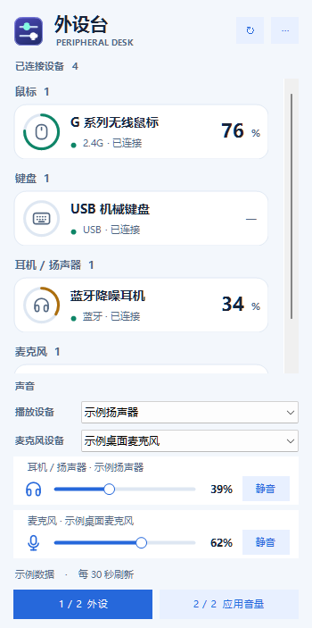
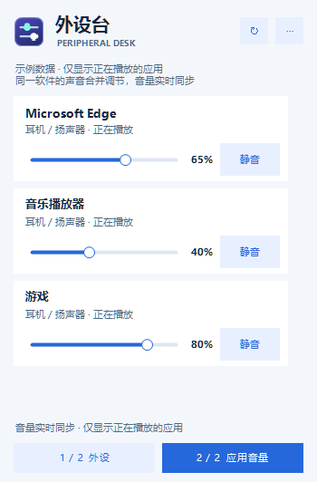

# 外设台 · Peripheral Desk v0.5.0-preview

Windows 10 / 11 x64。请从本仓库的 [Releases](../../releases) 下载 Windows ZIP，解压运行 **PeripheralDesk.exe**。不需要安装或联网。升级前请从旧版托盘菜单点「退出外设台」，再运行新版本。程序未签名，不会自行设置开机启动。

[下载 v0.5.0-preview](https://github.com/ShenkaiZhang/PeripheralDesk/releases/tag/v0.5.0-preview) · [更新记录](RELEASE_NOTES.md) · [验证记录](VALIDATION.md)

## 使用
- 点击任务栏右侧的外设台图标打开面板。面板只显示已确认在线的外设，按鼠标、键盘、耳机／扬声器、麦克风、手柄和其他外设分组。设备的电量只在面板显示；未提供电量不等于 0%。
- USB 和蓝牙设备优先使用 Windows 或设备报告的名字，不再内置鼠标型号库或蓝牙别名。USB 依靠标准 HID 类型识别有线外设；已识别为接收器但未收到外设实时响应时不将其当作在线外设。
- 电量优先使用系统或设备的实时反馈。对部分罗技、雷蛇和 CompX 鼠标、HyperX 耳机及 FA09 接收器，程序仍会在身份和接口验证后发送电量或连接查询。与鼠标灵敏度有关的查询、控制、型号库和档位均已移除；只保留电量协议所需的设备标识。仅有档位探测而没有独立电量协议的旧适配已移除，设备是否显示以 Windows 当前提供的信息为准。
- 声音区可分别切换默认播放和录音设备，音量和静音跟随对应的默认设备。不会主动改独立的默认通讯设备，不读取音频流。设置未确认时可走「··· → Windows 声音设置」。
- 底部「1 / 2 外设」与「2 / 2 应用音量」切换页面。第二页单独调整浏览器、音乐软件、游戏等应用的音量（0–100%）或静音；只控制应用音量，不改变设备总音量。仅显示 Windows 报告正在播放的会话，暂停或结束后隐藏；静音和 0% 不等于暂停，仍可取消静音或重新调高。
- 同一程序跨播放设备合并为一条控制，调节时统一控制该软件当前正在播放的会话。多个会话音量不一致时显示「音量不同」，滑块显示其中最大值，拖动后统一。同一浏览器的标签页不分别控制。受保护或系统无法访问的会话可能无法调节；独占模式/ASIO 等绕过 Windows 共享混音的声音不保证支持。
- 应用音量和播放状态通过 Windows 事件实时同步，不再每 2.5 秒刷新整页。原有行保持控件、顺序与位置，只有内容变化才更新；仅在应用加入或停止播放时增减行。第二页保持固定高度，超过可见区域时滚动。后台每 10 秒检查设备变化及连接恢复，数据无变化时不重绘列表；右上角刷新可立即重新读取。
- 「··· → 复制兼容性诊断」只复制本地列表，不会发送。列表不包含设备路径、序列号或蓝牙地址；设备显示名可能由你自行设定，分享前可检查。
- Esc 收起面板；托盘右键「退出外设台」结束程序。

## 升级、自启动与卸载
- 先退出旧版，再将下载 ZIP 解压到固定目录，运行其中的 `PeripheralDesk.exe`。不要同时运行多个版本；源代码压缩包需要先构建，不能代替 Windows 可运行 ZIP。
- 如需开机启动，按 Win+R 输入 `shell:startup`，将指向固定目录 EXE 的快捷方式放入启动文件夹。更新后若 EXE 路径不变，自启动无需调整；移动目录后必须修改快捷方式的目标及起始位置。
- 卸载时先退出程序，再删除对应的自启动快捷方式和解压目录。程序没有安装服务，不会自动修改自启动。
- Windows 可运行包的 SHA-256 见同一 Release 的 `SHA256SUMS.txt`；可用 PowerShell 的 `Get-FileHash -Algorithm SHA256` 对照核验。

## 构建和验证
- `Build.cmd` 使用本机 .NET Framework x64 C# 编译器生成 EXE。
- `powershell -NoProfile -ExecutionPolicy Bypass -File .\Package.ps1` 构建并生成版本化 Windows ZIP 和 `SHA256SUMS.txt`（默认在 `dist`）。`-UseExistingBuild` 仅打包已经验证的 EXE；不要用于过期构建。
- `Test.cmd` 编译测试程序、运行自动检查和 WinForms 界面测试。`PeripheralDesk.Tests.exe --verify-windows` 可只读检查 Windows 设备枚举、默认设备和音量（不会切换设备或音量）。`Start.cmd --demo` 展示样例数据。
- `PeripheralDesk.Tests.exe --verify-mixer-windows` 创建本测试进程的无声播放流，验证真实会话音量、静音、0/100 边界、失效会话拒绝、新播放/音量/静音/停止播放的事件通知；核对其他会话及设备总音量未变化，结束时恢复测试会话设置。需要本机 Windows 音频访问权限。
- `PeripheralDesk.Tests.exe --mixer-preview Mixer-preview.png` 生成第二页演示图；`--preview Panel-preview.png` 生成第一页演示图。演示模式不会调节真实应用。
- 应用音量实现使用 Windows [IAudioSessionManager2](https://learn.microsoft.com/en-us/windows/win32/api/audiopolicy/nn-audiopolicy-iaudiosessionmanager2) 与 [ISimpleAudioVolume](https://learn.microsoft.com/en-us/windows/win32/api/audioclient/nn-audioclient-isimpleaudiovolume)，没有新增依赖，不采集音频内容。
- 包内文件说明见 [FILES.md](FILES.md)，第三方参考见 [THIRD_PARTY_NOTICES.md](THIRD_PARTY_NOTICES.md)。项目本体采用 [MIT 许可证](LICENSE)；第三方内容仍按各自的许可条款使用。
